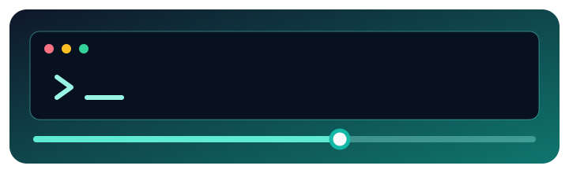

<p align="center"></p>
<p align="center"></p>
<p align="center">   </p>
<p align="center"></p>

## 🧭 Overview
Terminal Cast Viewer is an offline-first browser app for inspecting and replaying local asciinema v2 recordings. Your `.cast` file stays in your browser.

## ✨ Features
- 🎞️ Load asciinema v2 JSONL recordings from your device
- ⏯️ Play, pause, restart, and change playback speed
- 🔎 Search visible terminal output
- 🔒 Process recordings locally; nothing is uploaded

## 🖥️ Demo
No hosted demo is provided. Run the project locally using the quick-start instructions.

## 🚀 Quick Start
Requires Node.js 18 or newer.

```bash
npm start
```

Open http://127.0.0.1:4173 and choose a `.cast` file. Run checks with `npm test`.

## 🧰 Tech Stack
- Node.js built-in HTTP server
- Vanilla JavaScript modules and browser File API
- Node.js built-in test runner

## 🗂️ Folder Structure
```text
.
├── assets/mark.svg
├── tests/cast.test.js
├── app.js
├── cast.js
├── index.html
├── package.json
├── server.js
└── style.css
```

## 🗺️ Roadmap
- [ ] Add more real-world fixtures and edge-case examples
- [ ] Improve reporting and usability based on feedback
- [ ] Keep the core workflow lightweight and local-first

## 🤝 Contributing
Issues and focused pull requests are welcome. Please add or update tests when changing behavior.

## 📄 License
MIT License. See [LICENSE](LICENSE).

<p align="center"></p>
